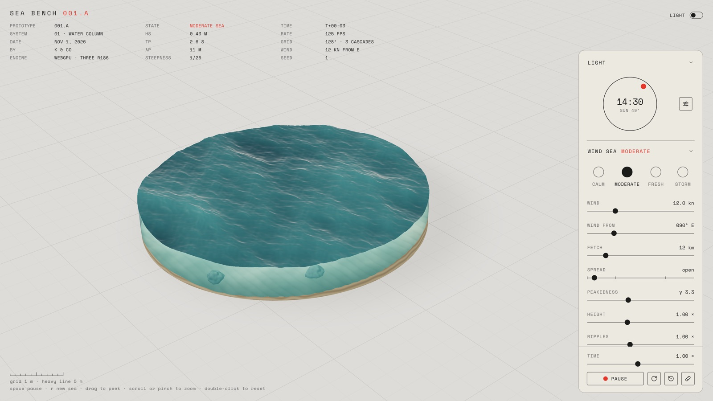

# Sea bench · system 01

A real sea in a cut-away column, and the bench that tunes it.

### ▶ Try it live: [kerem.co/projects/sea-bench](https://www.kerem.co/projects/sea-bench)

[](https://www.kerem.co/projects/sea-bench)

The water is a JONSWAP wave spectrum turned into three FFT height fields on the GPU every frame — three.js r186
WebGPU with TSL compute — and shaded in TSL. The same seeded spectrum is summed on the CPU, strongest waves
first, so anything that floats on it (a dinghy, in the project this feeds) feels the water it sees. The bench
exposes the whole model: wind and fetch, spread and peakedness, swell, chop, light, time.

**Needs a WebGPU browser**: Chrome / Edge, or Safari 26. Nothing is read back from the GPU; nothing falls back to WebGL.

## Run

```
npm install
npm run dev        # http://localhost:5173
npm run check      # typecheck + tests + build
```

Add `?n=256` to the URL for finer ripples on a strong GPU, `?check=1` to compile everything headlessly (see CLAUDE.md).

## Use the sea elsewhere

The package exports `src/sea` as TypeScript source, for a Vite + TypeScript project. Install it from a tag, with
three as your own dependency (it is a peer, so there is only ever one copy):

```
npm install three@0.186.0 github:gitkerem/sea-bench#v0.5.1
```

```ts
import * as THREE from 'three/webgpu';
import { SeaSim, SeaColumn, travelFromCompass } from 'sea-bench';

const renderer = new THREE.WebGPURenderer({ canvas });
await renderer.init();
const sea = new SeaSim(renderer, { N: 128 });
sea.setParams({ ...sea.params, windU: 8, fetch: 12000, travel: travelFromCompass(315) });
scene.add(new SeaColumn(sea, { radius: 7, waterY: 1.7 }));

// per frame
sea.step(dt);
const h = sea.heightAt(x, z);        // metres above mean level at world (x, z), from the same spectrum
renderer.render(scene, camera);
```

`SeaColumn` is the diorama; `makeSurfaceMaterial` and friends in `shading.ts` work on your own geometry.
`sea.U.off` scrolls the sea under a moving scene; `sea.U.lambda` is the chop.

Wind on the water: give the look a map of how hard the wind blows over the column (a red-channel texture laid
across the column's width, 0 light air … 1 gust) and turn it up. Gusts darken and roughen the water, lulls and lees
lighten it.

```ts
column.look.gustMap.value = myGustTexture;
column.look.gust.value = 1;          // 0 = off, the default
```

A moving seabed: slide the sand, its ripples, the wall's cut section and the rocks under the column by the ground
your scene covers. Rocks pass out through the wall and come round again; the caustics ride with the water.

```ts
sea.U.off.value.set(waterX, waterZ); // what you've covered through the water
column.setBedOffset(groundX, groundZ); // and over the ground (they differ when a current runs)
```

## Versions

The bench shows a prototype name in its title and the page name: **001** is this prototype, the water column, and
the letter moves on when a release is called a new one (a rethink starts **002.A**). Git tags stay semver underneath, and
the dinghy installs from those. Every change is in the bench's change log: hover the version in the title.

| Name | Tags | What changed |
|---|---|---|
| 001.A | v0.1.0 – v0.4.0 | the water column, its bench, the chopped sea under the hull |
| 001.B | v0.5.0 – | the instrument panel, shared with the dinghy simulator (`sea-bench/controls`); Space Mono throughout; scroll over a dial or ring to turn it; the change log |

## Layout

```
src/sea      the sea: spectrum, noise, GPU kernels, CPU sampler, shading, column
src/controls the instrument panel's controls, shared with the dinghy simulator (sea-bench/controls)
src/bench    the bench app: state, its panel, camera, main
test         vitest — the FFT formulation against a naive DFT, the spectrum's numbers
docs         SEA-MODEL.md (physics + conventions), DESIGN.md (system 01), HANDOFF.md
reference    the single-file artifact this was extracted from
```

## Credits

The FFT-on-TSL approach follows [iodiot/webgpu-ocean](https://github.com/iodiot/webgpu-ocean) (MIT); the
one-spectrum-for-CPU-and-GPU design follows [True Wind](https://github.com/hclivess/truewind) and
[Fair Winds](https://github.com/flowwweb/sailingsimulator). Spectrum after Hasselmann et al. (JONSWAP, 1973);
surface after Tessendorf (2001).

## Licence

MIT. See `LICENSE`.
